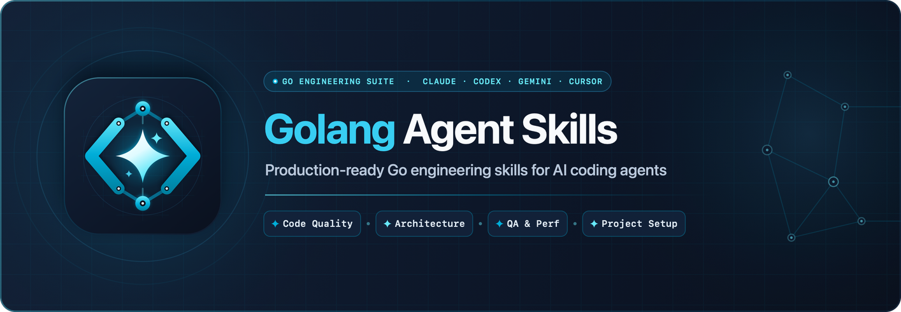

# Agent Skills for production-ready Golang projects

<!-- prettier-ignore-start -->

> [!NOTE]
> **Fork Notice**
>
> This repository is an actively maintained, production-oriented fork of [samber/cc-skills-golang](https://github.com/samber/cc-skills-golang), tailored and extended for real-world Go engineering workflows. Special thanks to [Samuel Berthe (@samber)](https://github.com/samber) and all upstream contributors for building such a strong foundation! For the original upstream project, please visit [samber/cc-skills-golang](https://github.com/samber/cc-skills-golang).

<!-- prettier-ignore-end -->

AI agent skills are reusable instruction sets that extend your coding assistant with domain-specific expertise, loaded on demand so they don't bloat your context. This repository covers **Go-specific** skills only (language, testing, security, observability, etc.); for dev workflow skills (git conventions, CI/CD, PR reviews) you'll want to add a separate skills plugin.

For non-Golang skills, please visit [cc-skills](https://github.com/samber/cc-skills).

<!-- prettier-ignore-start -->

> [!IMPORTANT]
> Bootstrapped with Claude Code by distilling my Go project commits. **Edited, tested, reviewed and reworked by a human**.
>
> **No AI slop here.** AI-made skills are useless.
>
> Built for Claude Code, Codex, Gemini, Copilot, Antigravity, Cursor...

<!-- prettier-ignore-end -->



## 🚀 How to use

**Install with [skills](https://skills.sh/) CLI** (universal, works with any [Agent Skills](https://agentskills.io)-compatible tool):

```bash
npx skills add https://github.com/eric642/cc-skills-golang --all
# or a single skill:
npx skills add https://github.com/eric642/cc-skills-golang --skill golang-performance
```

<!-- prettier-ignore-start -->

<details>
<summary>Claude Code</summary>

```bash
npx skills add https://github.com/eric642/cc-skills-golang -a claude-code --all
# or clone into the discovery directory:
git clone https://github.com/eric642/cc-skills-golang.git ~/.claude/skills/cc-skills-golang
```

</details>

<details>
<summary>Openclaw</summary>

Copy skills into the cross-client discovery directory:

```bash
git clone https://github.com/eric642/cc-skills-golang.git ~/.openclaw/skills/cc-skills-golang
# or in workspace:
git clone https://github.com/eric642/cc-skills-golang.git ~/.openclaw/workspace/skills/cc-skills-golang
```

</details>

<details>
<summary>Gemini CLI</summary>

```bash
gemini extensions install https://github.com/eric642/cc-skills-golang
```

Update with `gemini extensions update cc-skills-golang`.

</details>

<details>
<summary>Cursor</summary>

Copy skills into the cross-client discovery directory:

```bash
git clone https://github.com/eric642/cc-skills-golang.git ~/.cursor/skills/cc-skills-golang
```

Cursor auto-discovers skills from `.agents/skills/` and `.cursor/skills/`.

</details>

<details>
<summary>Copilot</summary>

Copy skills into the cross-client discovery directory:

```bash
/plugin install https://github.com/eric642/cc-skills-golang
# or
git clone https://github.com/eric642/cc-skills-golang.git ~/.copilot/skills/cc-skills-golang
```

Copilot auto-discovers skills from `.copilot/skills/`.

</details>

<details>
<summary>OpenCode</summary>

Copy skills into the cross-client discovery directory:

```bash
git clone https://github.com/eric642/cc-skills-golang.git ~/.agents/skills/cc-skills-golang
```

OpenCode auto-discovers skills from `.agents/skills/`, `.opencode/skills/`, and `.claude/skills/`.

</details>

<details>
<summary>Codex (OpenAI)</summary>

Install the plugin via the Codex CLI:

```bash
codex plugin add github:eric642/cc-skills-golang
```

Update with `codex plugin update cc-skills-golang`. Falls back to a manual clone if the marketplace path is unavailable:

```bash
git clone https://github.com/eric642/cc-skills-golang.git ~/.agents/skills/cc-skills-golang
```

Codex auto-discovers skills from `~/.agents/skills/` and `.agents/skills/`.

</details>

<details>
<summary>Antigravity</summary>

Clone and symlink into the cross-client discovery path:

```bash
git clone https://github.com/eric642/cc-skills-golang.git ~/.antigravity/skills/cc-skills-golang
```

Update with `cd ~/.antigravity/skills/cc-skills-golang && git pull`.

</details>

<!-- prettier-ignore-end -->

## 🧩 Skills

This repository provides **12 orthogonal, self-contained core Go skills**. Each skill owns a complete engineering pillar with zero cross-skill dependencies, using progressive disclosure (`SKILL.md` on activation + on-demand `references/` and `assets/`). Install all 12 skills together (`--all`) or pick any individual skill standalone (`--skill <name>`).

```
                     ┌────────────────────────────────────────┐
                     │         12 Core Golang Skills          │
                     └───────────────────┬────────────────────┘
                                         │
        ┌───────────────────┬────────────┴────────────┬───────────────────┐
        ▼                   ▼                         ▼                   ▼
┌───────────────┐   ┌─────────────────┐       ┌─────────────────┐   ┌──────────────┐
│ Code & Types  │   │ Arch & Refactor │       │ QA, Perf & Ops  │   │  Deps & CI   │
├───────────────┤   ├─────────────────┤       ├─────────────────┤   ├──────────────┤
│ code-quality  │   │ architecture    │       │ testing         │   │ dependencies │
│ idioms        │   │ refactoring     │       │ performance     │   │ ci           │
│ concurrency   │   │ database        │       │ observability   │   │              │
│               │   │                 │       │ security        │   │              │
└───────────────┘   └─────────────────┘       └─────────────────┘   └──────────────┘
```

- ✅ Published
- 👷 Work in progress
- ❌ To-do
- ⚡ Command available
- 🧠 Ultrathink automatically
- 🤖 Ultracode automatically
- **Error rate gap**: difference between Without Skill and With Skill pass rates (`Without% - With%` from [EVALUATIONS.md](./EVALUATIONS.md))
- **Description (tok)**: weight of the `description` field from YAML frontmatter, always loaded into context for skill triggering
- **SKILL.md (tok)**: weight of the full `SKILL.md` file loaded when the skill triggers
- **Directory (tok)**: weight of all files in the skill directory (`SKILL.md` + `references/` + `assets/`, excluding `evals/`)

<!-- markdownlint-disable table-column-style -->

| Skill | Flags | Error rate gap | Description (tok) | SKILL.md (tok) | Directory (tok) |
| --- | --- | --- | --- | --- | --- |
| ✅ `golang-architecture` | ⚡ 🤖 | -41% | 63 | 3,710 | 23,292 |
| ✅ `golang-ci` | ⚡ | -59% | 51 | 3,498 | 11,959 |
| ✅ `golang-code-quality` | ⚡ | -42% | 56 | 3,616 | 22,252 |
| ✅ `golang-concurrency` | ⚡ 🤖 | -37% | 48 | 3,432 | 11,217 |
| ✅ `golang-database` | ⚡ | -38% | 49 | 2,672 | 7,572 |
| ✅ `golang-dependencies` | ⚡ | -42% | 53 | 3,502 | 14,629 |
| ✅ `golang-idioms` | ⚡ | -45% | 57 | 4,377 | 17,334 |
| ✅ `golang-observability` | ⚡ 🤖 | -37% | 45 | 3,001 | 19,256 |
| ✅ `golang-performance` | ⚡ 🧠 🤖 | -42% | 52 | 4,558 | 65,339 |
| ✅ `golang-refactoring` | ⚡ 🧠 🤖 | -43% | 51 | 4,876 | 42,134 |
| ✅ `golang-security` | ⚡ 🧠 🤖 | -32% | 47 | 3,095 | 24,367 |
| ✅ `golang-testing` | ⚡ 🧠 🤖 | -32% | 49 | 3,119 | 7,994 |
| **Total (12 skills)** | | **-41%** | **621** | **43,456** | **267,345** |

## 🧪 Skill evaluations

|             | With Skill          | Without Skill       | Delta     |
| ----------- | ------------------- | ------------------- | --------- |
| **Overall** | **2435/2488 (98%)** | **1408/2488 (57%)** | **+41pp** |

See [EVALUATIONS.md](./EVALUATIONS.md) for the full per-skill breakdown.

## 📖 Skills description

### Code & Types

#### `golang-code-quality`

Go code style, naming, linting, and documentation standards. Control-flow readability, MixedCaps and anti-stutter identifier conventions, `golangci-lint` (`.golangci.yml` presets, `nolint` discipline), godoc comments, runnable `Example` functions, and project documentation templates (`README.md`, `CONTRIBUTING.md`, `CHANGELOG.md`, `llms.txt`).

#### `golang-idioms`

Core Go type, collection, error-handling, and defensive safety idioms. Struct layout and tags, consumer-defined interfaces, pointer vs. value receivers, generics, slice/map internals and aliasing safety, error wrapping (`%w`, `errors.Is`/`As`, sentinel and custom errors), typed-nil traps, and numeric overflow protection.

#### `golang-concurrency`

Go concurrency and `context.Context` patterns. Goroutine lifecycle ownership, channel vs. mutex selection, `errgroup`, `singleflight`, worker pools, fan-out/fan-in pipelines, cancellation, timeouts, `context.WithoutCancel`, and leak/race prevention.

### Architecture & Refactoring

#### `golang-architecture`

Go service and CLI architecture. Standard `cmd/`/`internal/`/`pkg/` and `go.work` layouts, flat vs. clean/hexagonal design, idiomatic Go patterns (functional options, middleware, circuit breakers), constructor and container DI (`uber-go/fx`, `dig`, `samber/do`), Cobra/Viper CLI design, exit codes, and graceful shutdown.

#### `golang-refactoring`

Safe, tool-driven Go refactoring, semantic navigation, and language modernization. `gopls` via MCP/LSP/CLI (definition, references, diagnostics, rename, extract/inline), Go version modernization (`modernize`, `slices`/`maps`/`cmp`/`iter`, `b.Loop`, `t.Context`, `synctest`), `gofmt -r`, `gopatch`, breaking import cycles, and staged PR workflows.

#### `golang-database`

Production Go SQL database access with `database/sql`, `sqlx`, and `pgx` across PostgreSQL, MySQL, and SQLite. Parameterized queries, connection pool sizing, transactions and isolation levels, row scanning, query performance, and database testing patterns.

### QA, Performance & Ops

#### `golang-testing`

Production-ready Go testing. Table-driven tests, `testify` assertions, `t.Helper()`, `t.Parallel()`, fuzzing, goroutine leak detection (`goleak`), HTTP/integration testing with build tags, mocking strategies, `testing/synctest`, and coverage discipline.

#### `golang-performance`

Unified Go debugging, benchmarking, profiling, and hot-path optimization loop (`Diagnose → Measure → Profile → Optimize`). Delve (`dlv`), `-race`, `GODEBUG`, `pprof` and execution `trace`, `testing.B` and `benchstat` CI regression detection, escape analysis, allocation reduction, memory layout, caching, and GC tuning.

#### `golang-observability`

Always-on Go production telemetry. Structured logging (`log/slog`), Prometheus metrics, OpenTelemetry distributed tracing, trace-log correlation, continuous profiling, RUM tracking, alerting rules, and Grafana dashboards.

#### `golang-security`

Go application security for coding, PR review, and full-codebase SAST audits. Injection prevention (SQL, command, XSS), cryptography, SSRF and network safety, path traversal and filesystem hardening, cookie/session security, secrets management, and `gosec`/`govulncheck` workflows.

### Dependencies & CI

#### `golang-dependencies`

End-to-end Go dependency lifecycle. Stdlib-first library selection, `godig` (`pkg.go.dev` CLI/MCP) package inspection, `go.mod` MVS versioning, `replace` and `tool` directives, multi-module workspaces, upgrades, and `govulncheck` vulnerability auditing.

#### `golang-ci`

CI/CD pipelines and repository automation for Go projects using GitHub Actions. Build, test, lint, integration, Docker, GoReleaser, CodeQL/security scanning, Dependabot/Renovate automation, and AI-driven PR review workflows.

## 🕵 Use in CI for AI-driven reviews

Add AI agents as PR reviewers alongside traditional static analysis. When configured with this skill plugin, the agent applies the relevant Go skills per review area — catching architectural drift, logic bugs, and concurrency hazards that linters cannot detect.

See [GOLANG-AI-DRIVEN-REVIEW.md](./GOLANG-AI-DRIVEN-REVIEW.md) for full setup instructions (Claude Code Action and GitHub Copilot).

## 🎯 Tuning Skill Triggers

If a skill triggers too often or not often enough, please [open an issue](https://github.com/eric642/cc-skills-golang/issues) suggesting a description change. The `description` field in SKILL.md frontmatter is the primary triggering mechanism — small wording adjustments can significantly improve trigger accuracy. Finally, `SKILL.md` files act as concise entrypoints that lazy-load deep references from `references/` and templates from `assets/` on demand.

## 🧩 Context Efficiency

Consolidating into **12 orthogonal, self-contained core skills** keeps startup overhead minimal while eliminating cross-skill coupling. All 12 skill descriptions load just **621 tokens** at startup (down from 1,382 tokens across the earlier 29-skill catalog); full `SKILL.md` bodies and `references/` files are only pulled into context when relevant. Note:

- Mechanical style and lint checks belong to `golangci-lint` (configured via the `.golangci.yml` bundled in `golang-code-quality`); the skills focus on design, readability, and judgment calls linters cannot enforce.
- Security rules in `golang-security` complement static analyzers (`gosec`, `govulncheck`) with threat-modeling and codebase audit methodology.
- Every skill is standalone with zero cross-skill `@` pointers — install `--all` for full Go coverage or `--skill <name>` for a single domain.

## ✍️ Contribute

- **150–250 characters (~30–55 tokens, ≤ 300 max) per skill description** — what? when to use this skill?
- **≤ 4,000 tokens target (< 5,000 hard ceiling) per `SKILL.md`** — keep the main file focused on essentials (~160–290 lines)
- **Use secondary markdown files for depth** — reference them from `SKILL.md` with relative links (e.g., `[Logging](references/logging.md)`). They are read on demand when the topic is relevant, so they don't count against the startup budget
- **Keep skills self-contained** — never add cross-skill `@` or `→ See` pointers between skills; progressive disclosure stays inside each skill directory
- **2–3 core skills loaded simultaneously** in a typical session — design skills to coexist cleanly
- **Stay around ~10–12k tokens of total loaded `SKILL.md`** anytime to avoid degrading response quality

For more guidelines, please check [CLAUDE.md](./CLAUDE.md).

## 🙏 Acknowledgments

This project builds upon [samber/cc-skills-golang](https://github.com/samber/cc-skills-golang), originally created by [Samuel Berthe (@samber)](https://github.com/samber). Special thanks to Samuel and all upstream contributors for establishing such a solid, high-signal foundation of Go agent skills — please consider starring the [upstream repository](https://github.com/samber/cc-skills-golang) or sponsoring the original author as well.

## 📝 License

Copyright © 2026 [Samuel Berthe](https://github.com/samber).

This project is under [MIT](./LICENSE) license.
